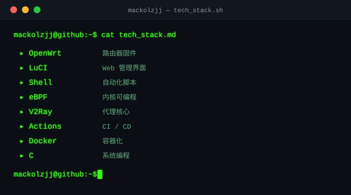

<!-- 顶部粒子 Banner（自托管） -->

  

<h1 align="center">// NETWORK &amp; FIRMWARE HACKER</h1>

## 🐍 贡献蛇 · Contribution Snake

  

## 🛠 技术栈 · Tech Stack

  

## 📦 项目 · Projects

| 项目 | 说明 | 技术 |
| --- | --- | --- |
| [`Phicomm-N1_OpenWrt`](https://github.com/mackolzjj/Phicomm-N1_OpenWrt) | 斐讯 N1 OpenWrt 固件（eBPF / BTF 底座，可手动装 honk） | OpenWrt 25.12 · 6.12.y |
| [`Phicomm-N1_ImmortalWrt`](https://github.com/mackolzjj/Phicomm-N1_ImmortalWrt) | 斐讯 N1 ImmortalWrt 固件（内置 honk 代理） | ImmortalWrt 25.12 · 6.18.y |

## 🔗 链接 · Links

  
  

<!-- 波浪页脚 -->

  

